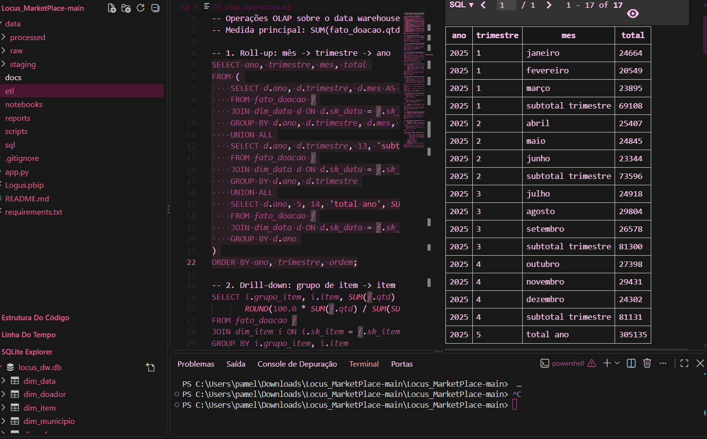
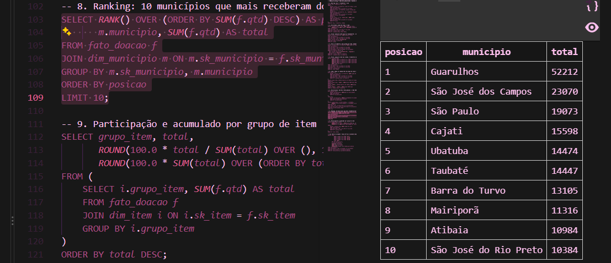

# 🤝 Locus MarketPlace — Conectando Doadores, Centros de Doação e Pessoas Carentes


> Projeto acadêmico desenvolvido para a disciplina de **PROJETO INTEGRADOR: APOIO DECISÓRIO AOS NEGÓCIOS**  
> SENAC EAD — Banco de Dados

🌐 **Acesse o Dashboard Interativo Online:** [locusmarketplace.streamlit.app](https://locusmarketplace.streamlit.app/)

## 📌 Sobre o Projeto

O **Locus MarketPlace** é uma iniciativa de análise e visualização de dados voltada para facilitar a comunicação entre:

- 🧑‍🤝‍🧑 **Doadores** — pessoas físicas ou jurídicas que desejam contribuir
- 🏢 **Centros de Doação** — CRAS, CREAS e ONGs cadastradas
- ❤️ **Pessoas em Situação de Vulnerabilidade** — beneficiários dos serviços de assistência social

## 📸 Demonstração

### 🎬 Vídeo de demonstração

▶️ **[Assistir ao vídeo de demonstração no YouTube](https://youtu.be/S8pQINfnqjw)** (1 min, com legendas)

[](https://youtu.be/S8pQINfnqjw)

O arquivo do vídeo também está no repositório: [`docs/video/locus_marketplace_demo.mp4`](docs/video/locus_marketplace_demo.mp4) ([baixar](https://github.com/dmourans/Locus_MarketPlace/raw/main/docs/video/locus_marketplace_demo.mp4)).

Roteiro do vídeo:

1. **Problema e objetivo** — conectar doadores, centros de doação (CRAS, CREAS e ONGs) e pessoas em situação de vulnerabilidade.
2. **Modelo dimensional** — constelação de fatos com 2 fatos e 6 dimensões ([`docs/modelo_dimensional.md`](docs/modelo_dimensional.md)).
3. **ETL** — execução de `python etl/build_dw.py` e reconciliação da carga.
4. **Operações OLAP** — consultas de [`sql/05_olap_operacoes.sql`](sql/05_olap_operacoes.sql).
5. **Dashboard na nuvem** — navegação no painel publicado no Streamlit.
6. **Repositório** — estrutura do projeto e contribuições dos integrantes.

### 📊 Dashboard

Painel interativo publicado em [locusmarketplace.streamlit.app](https://locusmarketplace.streamlit.app/).

### 🧮 Consultas OLAP sobre o Data Warehouse

**Roll-up** — itens doados por mês, com subtotal por trimestre e total do ano:



**Drill-across** — doações × rede CRAS/CREAS por município:


**Ranking** — 10 municípios que mais receberam doações:



As evidências das 10 consultas estão em [`docs/evidencias_olap/`](docs/evidencias_olap/).

## 📂 Estrutura do Repositório

```
Locus_MarketPlace
├── data/
│   ├── processed/
│   │   └── municipios_tratado.csv
│   └── raw/
│       ├── CRAS_BRASIL.csv
│       ├── CREAS_BRASIL.csv
│       ├── Donatarios2025.csv
│       ├── ONGS_SP.csv
│       ├── ONGS_SP_TOP100_POP.csv
│       ├── doadores2025.csv
│       ├── doações2024.csv
│       └── municipios.csv
├── docs/
│   ├── evidencias_olap/          # capturas das 10 consultas OLAP
│   ├── video/                    # vídeo de demonstração
│   └── modelo_dimensional.md     # documentação do modelo dimensional
├── etl/
│   ├── extract_transform.py      # extração e transformação (regras T1 a T8)
│   └── build_dw.py               # orquestra staging, DDL, DML e conferência da carga
├── notebooks/
│   ├── analise_descritiva.ipynb
│   └── analise_municipios.ipynb
├── reports/
│   └── relatorio_analise.html
├── scripts/
│   ├── analise_descritiva.py
│   ├── analise_municipios.py
│   ├── municipios_brasileiros.py
│   └── tabela_ongs_SP.py
├── sql/
│   ├── 01_stg_ddl.sql            # tabelas de staging
│   ├── 02_stg_load.sql           # carga manual do staging
│   ├── 03_dw_ddl.sql             # dimensões e fatos
│   ├── 04_dw_dml.sql             # carga do data warehouse
│   ├── 05_olap_operacoes.sql     # 10 consultas OLAP
│   └── README.MD
├── app.py                        # dashboard Streamlit
├── requirements.txt
├── .gitignore
└── README.md
```

O banco `sql/locus_dw.db` e a pasta `data/staging/` não são versionados: são gerados por `python etl/build_dw.py`.

---

## 🗃️ Fontes de Dados

| Dataset | Fonte | Descrição |
|---|---|---|
| `CRAS_BRASIL.csv` | [MDS / dados.gov.br](https://dados.gov.br) | Centros de Referência de Assistência Social |
| `CREAS_BRASIL.csv` | [MDS / dados.gov.br](https://dados.gov.br) | Centros de Referência Especializados |
| `ONGS_SP.csv` | Secretaria de Desenvolvimento Social SP | ONGs ativas no estado de SP |
| `doadores2025.csv` | Dados próprios / simulados | Perfil de doadores cadastrados |
| `doações2024.csv` | Dados próprios / simulados | Histórico de doações realizadas |
| `Donatarios2025.csv` | Base de doações do projeto | Doações de 2025 com item, perfil do doador e unidade (fonte do `fato_doacao`) |
| `municipios_tratado.csv` | Base de municípios tratada pelo grupo | Municípios com código IBGE, UF, DDD e coordenadas |

## 🧱 Data Warehouse

Esquema analítico em **constelação de fatos**, com 6 dimensões e 2 fatos, em SQLite. O data warehouse é alimentado por `CRAS_BRASIL.csv`, `CREAS_BRASIL.csv`, `municipios_tratado.csv` e `Donatarios2025.csv`.

- Modelo dimensional: [`docs/modelo_dimensional.md`](docs/modelo_dimensional.md)
- ETL: [`etl/extract_transform.py`](etl/extract_transform.py) e [`etl/build_dw.py`](etl/build_dw.py)
- Scripts SQL e instruções: [`sql/README.MD`](sql/README.MD)

## 🛠️ Tecnologias Utilizadas

- **Python 3.10+**
- **SQLite 3** — staging e data warehouse
- **Streamlit** — dashboard interativo e publicação em nuvem
- **Pandas** — manipulação e análise de dados
- **NumPy** — operações numéricas
- **Matplotlib / Seaborn** — visualizações gráficas
- **Jupyter Notebook / Google Colab** — ambiente de desenvolvimento
- **Git / GitHub** — versionamento e entrega do projeto

## 🔬 Detalhamento Técnico

### Arquitetura

```
CSVs de origem ──► ETL em Python ──► staging (stg_*) ──► data warehouse SQLite ──► consultas OLAP ──► dashboard Streamlit
  (data/)            (etl/)           (data/staging/)      (sql/locus_dw.db)         (sql/05)             (app.py)
```

### Extração e transformação

[`etl/extract_transform.py`](etl/extract_transform.py) lê as quatro fontes como texto, confere o cabeçalho com o layout de [`sql/01_stg_ddl.sql`](sql/01_stg_ddl.sql) e aplica oito regras de qualidade. As linhas que não passam vão para `data/staging/rejeitados.csv` com o motivo, e a conta fecha: lidas = gravadas + duplicadas + rejeitadas.

| Regra | Tema | Tratamento |
|---|---|---|
| T1 | Layout | Cabeçalho no padrão do staging; linhas com número de campos diferente são rejeitadas |
| T2 | Espaços | Remove pontas, repetições, quebras de linha e caracteres invisíveis |
| T3 | Ausentes | `-`, `s/n` e `0` viram vazio nos campos opcionais |
| T4 | Categorias | UF, sexo, primeira doação e tipo padronizados; município em maiúsculas e sem acento |
| T5 | Datas | Data e horário validados; dia da semana recalculado |
| T6 | Números | Idade, quantidade e códigos dentro das restrições do DW |
| T7 | Localização | UF e cidade pelo código IBGE; CEP com 8 dígitos |
| T8 | Duplicados | Remove linhas idênticas e chaves de negócio repetidas |

### Carga (DDL e DML)

[`etl/build_dw.py`](etl/build_dw.py) executa os scripts na ordem e recria o banco a cada execução:

| Script | Tipo | O que faz |
|---|---|---|
| [`sql/01_stg_ddl.sql`](sql/01_stg_ddl.sql) | DDL | Cria as tabelas de staging |
| [`sql/02_stg_load.sql`](sql/02_stg_load.sql) | Carga | Importa os CSVs para o staging pelo `sqlite3` (alternativa manual ao ETL em Python) |
| [`sql/03_dw_ddl.sql`](sql/03_dw_ddl.sql) | DDL | Cria dimensões e fatos com PK, FK, `UNIQUE` e `CHECK` |
| [`sql/04_dw_dml.sql`](sql/04_dw_dml.sql) | DML | Carrega dimensões e fatos a partir do staging, em uma transação (`BEGIN` / `COMMIT`) |

Ao final, o ETL compara o total de linhas do staging com o dos fatos e termina com erro se houver diferença.

### Modelo dimensional

| Tabela | Tipo | Grão | Linhas |
|---|---|---|---:|
| `fato_doacao` | Fato | Uma linha por doação; medida `qtd` (itens doados) | 12.217 |
| `fato_unidade_assistencial` | Fato | Uma linha por CRAS ou CREAS; medida `qtd_unidades` | 11.946 |
| `dim_data` | Dimensão | Dia (mês → trimestre → ano) | 362 |
| `dim_uf` | Dimensão | Unidade da federação | 27 |
| `dim_municipio` | Dimensão | Município (código IBGE) | 5.571 |
| `dim_unidade` | Dimensão | Unidade ONG, CRAS ou CREAS | 12.007 |
| `dim_item` | Dimensão | Item doado (grupo → item) | 17 |
| `dim_doador` | Dimensão | Perfil do doador (idade, sexo, primeira doação) | 287 |

`dim_data`, `dim_uf`, `dim_municipio` e `dim_unidade` são dimensões conformadas, usadas pelos dois fatos. Toda dimensão tem chave substituta (`sk_*`) e mantém a chave natural da origem. Diagrama, decisões de modelagem e comparação com a primeira etapa em [`docs/modelo_dimensional.md`](docs/modelo_dimensional.md).

### Operações OLAP

As consultas estão em [`sql/05_olap_operacoes.sql`](sql/05_olap_operacoes.sql) e são executadas pela página **Data Warehouse e OLAP** do dashboard.

| Nº | Operação | O que mostra | Evidência |
|---:|---|---|---|
| 1 | Roll-up | Itens doados por mês, trimestre e ano | [01_rollup.png](docs/evidencias_olap/01_rollup.png) |
| 2 | Drill-down | Grupo de item detalhado por item | [02_drilldown.png](docs/evidencias_olap/02_drilldown.png) |
| 3 | Slice | Evolução mensal do grupo Alimentação | [03_slice.png](docs/evidencias_olap/03_slice.png) |
| 4 | Dice | 1º semestre × dois grupos de item × sexo feminino | [04_dice.png](docs/evidencias_olap/04_dice.png) |
| 5 | Pivot | Grupo de item nas linhas, trimestres nas colunas | [05_pivot.png](docs/evidencias_olap/05_pivot.png) |
| 6 | Cube | Todas as combinações de grupo e trimestre | [06_cube.png](docs/evidencias_olap/06_cube.png) |
| 7 | Drill-across | Doações × rede CRAS/CREAS por município | [07_drill_across.png](docs/evidencias_olap/07_drill_across.png) |
| 8 | Ranking | 10 municípios que mais receberam doações | [08_ranking.png](docs/evidencias_olap/08_ranking.png) |
| 9 | Participação | Participação e acumulado por grupo de item | [09_participacao_acumulado.png](docs/evidencias_olap/09_participacao_acumulado.png) |
| 10 | Perfil do doador | Faixa etária e primeira doação | [10_perfil_doador.png](docs/evidencias_olap/10_perfil_doador.png) |

## ▶️ Como Executar

### 1. Clone o repositório

```bash
git clone https://github.com/dmourans/Locus_MarketPlace.git
cd Locus_MarketPlace
```

### 2. Instale as dependências

```bash
pip install -r requirements.txt
```

### 3. Gere o Data Warehouse (ETL)

Executa a extração, a transformação e a carga, e cria o banco `sql/locus_dw.db`:

```bash
python etl/build_dw.py
```

Ao final, o script imprime a conferência entre o staging e os fatos. Se o banco não existir, o dashboard executa essa etapa sozinho na primeira abertura.

### 4. Execute o Dashboard (Web App)

Para abrir a interface do painel interativo no seu navegador:

```bash
streamlit run app.py
```

### 5. (Opcional) Execute o notebook de análise

Para ver a etapa de tratamento dos dados:

```bash
jupyter notebook notebooks/analise_municipios.ipynb
```

## 👥 Integrantes do Grupo

| Avatar | Nome | GitHub |
|:---:|---|---|
|  | Antônio Carlos | [@ACSJr](https://github.com/ACSJr) |
|  | Deivid Nogueira | [@dmourans](https://github.com/dmourans) |
|  | Denys Oliveira | [@dns97](https://github.com/denysOliveira97) |
|  | Mateus Fernandes | [@mateusfeoliveira](https://github.com/mateusfeoliveira) |
|  | Pamela Soares | [@PaamSoares](https://github.com/PaamSoares) |
|  | Rauany Costa | [@Rau-Costa](https://github.com/Rau-Costa) |

## 📄 Licença

Este projeto é de uso acadêmico. Dados públicos utilizados conforme licença aberta do [dados.gov.br](https://dados.gov.br).


