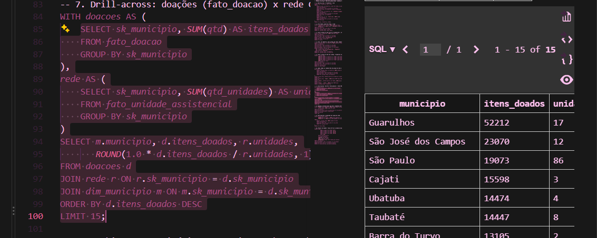

# 🤝 Locus MarketPlace — Conectando Doadores, Centros de Doação e Pessoas Carentes


> Projeto acadêmico desenvolvido para a disciplina de **PROJETO INTEGRADOR: APOIO DECISÓRIO AOS NEGÓCIOS**  
> SENAC EAD — Banco de Dados

🌐 **Acesse o Dashboard Interativo Online:** [locusmarketplace.streamlit.app](https://locusmarketplace.streamlit.app/)

## 📌 Sobre o Projeto

O **Locus MarketPlace** é uma iniciativa de análise e visualização de dados voltada para facilitar a comunicação entre:

- 🧑‍🤝‍🧑 **Doadores** — pessoas físicas ou jurídicas que desejam contribuir
- 🏢 **Centros de Doação** — CRAS, CREAS e ONGs cadastradas
- ❤️ **Pessoas em Situação de Vulnerabilidade** — beneficiários dos serviços de assistência social

## 📸 Demonstração

### 🎬 Vídeo de demonstração

▶️ **[Assistir ao vídeo de demonstração](docs/video/locus_marketplace_demo.mp4)** (1 min, com legendas)

Roteiro do vídeo:

1. **Problema e objetivo** — conectar doadores, centros de doação (CRAS, CREAS e ONGs) e pessoas em situação de vulnerabilidade.
2. **Modelo dimensional** — constelação de fatos com 2 fatos e 6 dimensões ([`docs/modelo_dimensional.md`](docs/modelo_dimensional.md)).
3. **ETL** — execução de `python etl/build_dw.py` e reconciliação da carga.
4. **Operações OLAP** — consultas de [`sql/05_olap_operacoes.sql`](sql/05_olap_operacoes.sql).
5. **Dashboard na nuvem** — navegação no painel publicado no Streamlit.
6. **Repositório** — estrutura do projeto e contribuições dos integrantes.

### 📊 Dashboard

Painel interativo publicado em [locusmarketplace.streamlit.app](https://locusmarketplace.streamlit.app/).

### 🧮 Consultas OLAP sobre o Data Warehouse

**Roll-up** — itens doados por mês, com subtotal por trimestre e total do ano:


**Drill-across** — doações × rede CRAS/CREAS por município:



**Ranking** — 10 municípios que mais receberam doações:


As evidências das 10 consultas estão em [`docs/evidencias_olap/`](docs/evidencias_olap/).

## 📂 Estrutura do Repositório

```
Locus_Marketplace
├── data/
│   └── processed/
│   │   └── municipios_tratado.py
│   └──raw/
│       ├── CRAS_BRASIL.csv
│       ├── CREAS_BRASIL.csv
│       ├── ONGS_SP.csv
│       ├── doadores2025.csv
│       └── doações2024.csv
├── notebooks/
│   └── analise_municipios.ipynb
├── scripts/
│   └── municipios_brasileiros
│   └── tabela_ongs_SP.py  
├── .gitignore
├── requirements.txt
└── README.md
```

---

## 🗃️ Fontes de Dados

| Dataset | Fonte | Descrição |
|---|---|---|
| `CRAS_BRASIL.csv` | [MDS / dados.gov.br](https://dados.gov.br) | Centros de Referência de Assistência Social |
| `CREAS_BRASIL.csv` | [MDS / dados.gov.br](https://dados.gov.br) | Centros de Referência Especializados |
| `ONGS_SP.csv` | Secretaria de Desenvolvimento Social SP | ONGs ativas no estado de SP |
| `doadores2025.csv` | Dados próprios / simulados | Perfil de doadores cadastrados |
| `doações2024.csv` | Dados próprios / simulados | Histórico de doações realizadas |

Esquema analítico com 6 dimensões e 2 fatos. Scripts e instruções em [`sql/README.md`](sql/README.md).

## 🛠️ Tecnologias Utilizadas

- **Python 3.10+**
- **Pandas** — manipulação e análise de dados
- **NumPy** — operações numéricas
- **Matplotlib** — visualizações gráficas
- **Jupyter Notebook / Google Colab** — ambiente de desenvolvimento

## ▶️ Como Executar

### 1. Clone o repositório

```bash
git clone https://github.com/dmourans/Locus_MarketPlace.git
cd <nome-do-repo>
```

### 2. Instale as dependências

```bash
pip install -r requirements.txt
```

### 3. Execute o Dashboard (Web App)

Para abrir a interface do painel interativo no seu navegador:

```bash
streamlit run app.py
```

### 4. (Opcional) Execute o notebook de análise

Para ver a etapa de tratamento dos dados:

```bash
jupyter notebook analise_municipios.ipynb
```

## 👥 Integrantes do Grupo

| Avatar | Nome | GitHub |
|:---:|---|---|
|  | Anderson Belarmino | [@Anr30](https://github.com/Anr30) |
|  | Antônio Carlos | [@ACSJr](https://github.com/ACSJr) |
|  | Deivid Nogueira | [@dmourans](https://github.com/dmourans) |
|  | Denys Oliveira | [@dns97](https://github.com/denysOliveira97) |
|  | Mateus Fernandes | [@mateusfeoliveira](https://github.com/mateusfeoliveira) |
|  | Pamela Soares | [@PaamSoares](https://github.com/PaamSoares) |
|  | Rauany Costa | [@Rau-Costa](https://github.com/Rau-Costa) |

## 📄 Licença

Este projeto é de uso acadêmico. Dados públicos utilizados conforme licença aberta do [dados.gov.br](https://dados.gov.br).


