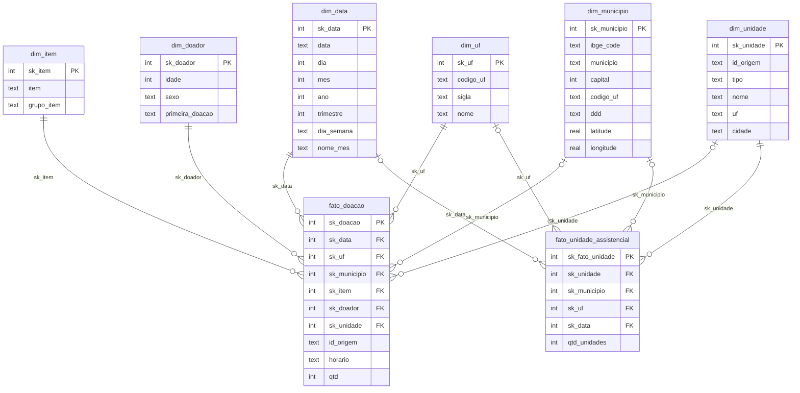

# Modelo Dimensional — Locus MarketPlace (Etapa 2)

> Documento do modelo analítico implementado em `sql/03_dw_ddl.sql` (DDL) e carregado por `sql/04_dw_dml.sql` (DML).
> Banco: SQLite 3 (`sql/locus_dw.db`, gerado por `python etl/build_dw.py`).
> Autor desta documentação: Antônio Carlos ([@ACSJr](https://github.com/ACSJr))

## 1. Visão geral

O data warehouse segue o modelo **constelação de fatos** (*fact constellation* / *galaxy schema*): **2 tabelas fato** que compartilham **dimensões conformadas**, permitindo cruzar as doações com a rede de assistência social (operação *drill-across*).

| Tipo | Tabelas |
|---|---|
| Fatos (2) | `fato_doacao`, `fato_unidade_assistencial` |
| Dimensões (6) | `dim_data`, `dim_uf`, `dim_municipio`, `dim_item`, `dim_doador`, `dim_unidade` |

Convenções adotadas:

- Prefixos `stg_` (staging), `dim_` e `fato_` — o SQLite não tem `CREATE SCHEMA`.
- Toda dimensão tem **chave substituta** (`sk_*`, `INTEGER PRIMARY KEY AUTOINCREMENT`) e mantém a **chave natural** da origem com `UNIQUE` (ex.: `ibge_code`, `data`, `(tipo, id_origem)`).
- Integridade garantida por `FOREIGN KEY` (com `PRAGMA foreign_keys = ON`) e regras de domínio com `CHECK`.

## 2. Diagrama

## 3. Tabelas fato

### 3.1 `fato_doacao`

| Item | Descrição |
|---|---|
| **Processo de negócio** | Registro de doações feitas por doadores a unidades (ONG / CRAS / CREAS) |
| **Grão** | Uma linha por registro de doação da origem (`Donatarios2025.csv`, coluna `id` → `id_origem`) |
| **Medida** | `qtd` — quantidade de itens doados (**aditiva** em todas as dimensões) |
| **Dimensões** | data, UF, município, item, doador, unidade |
| **Atributos degenerados** | `id_origem` (id da doação na origem) e `horario` |
| **Nulos permitidos** | `sk_municipio` e `sk_unidade` — a doação é mantida mesmo quando o município ou a unidade não casam com a dimensão, para não perder volume doado |

### 3.2 `fato_unidade_assistencial`

| Item | Descrição |
|---|---|
| **Processo de negócio** | Cobertura da rede de assistência social (CRAS e CREAS) |
| **Grão** | Uma linha por equipamento CRAS ou CREAS cadastrado |
| **Medida** | `qtd_unidades` — sempre 1; somada, dá o nº de unidades (**fato sem medida / factless**, usado para contagem) |
| **Dimensões** | unidade, município, UF, data (data da última atualização do cadastro) |
| **Natureza** | Fotografia (*snapshot*) da rede no momento da carga |

## 4. Dimensões

| Dimensão | Grão (1 linha por…) | Chave natural | Atributos / hierarquia | Origem | Usada por |
|---|---|---|---|---|---|
| `dim_data` | dia | `data` (AAAA-MM-DD) | dia → mês → trimestre → ano; `dia_semana`, `nome_mes` | datas das doações + datas de atualização CRAS/CREAS | ambos os fatos |
| `dim_uf` | unidade da federação | `codigo_uf` / `sigla` | código IBGE, sigla, nome (27 UFs, carga fixa) | DML (lista oficial IBGE) | ambos os fatos |
| `dim_municipio` | município | `ibge_code` | nome, capital, `codigo_uf`, DDD, latitude/longitude, fuso | `municipios_tratado.csv` | ambos os fatos |
| `dim_item` | item doado | `(item, grupo_item)` | grupo_item → item | doações | `fato_doacao` |
| `dim_doador` | perfil de doador | `(idade, sexo, primeira_doacao)` | idade, sexo, se é a 1ª doação | doações | `fato_doacao` |
| `dim_unidade` | unidade ONG / CRAS / CREAS | `(tipo, id_origem)` | tipo, nome, UF, cidade, endereço, bairro, CEP, telefone | doações (ONGs) + `CRAS_BRASIL.csv` + `CREAS_BRASIL.csv` | ambos os fatos |

Observações de modelagem:

- **Dimensões conformadas**: `dim_data`, `dim_uf`, `dim_municipio` e `dim_unidade` são compartilhadas pelos dois fatos. É isso que viabiliza o *drill-across* (consulta 7 de `sql/05_olap_operacoes.sql`: doações × rede CRAS/CREAS por município).
- **`dim_doador` é uma dimensão de perfil (mini-dimensão)**: a base não identifica o doador individualmente, então cada linha é uma combinação distinta de idade, sexo e primeira doação. Ela responde "que perfil doa?", não "quem doou?".
- **Hierarquia geográfica UF → município**: `dim_municipio` guarda `codigo_uf`, e os fatos referenciam `sk_uf` e `sk_municipio` separadamente. Assim a análise por UF funciona mesmo nas doações cujo município não foi casado.
- **Histórico**: a carga apaga e recarrega tudo (`DELETE` + `INSERT` dentro de `BEGIN/COMMIT`), o que equivale a **SCD tipo 1** (sem histórico de alterações nas dimensões).

### 4.1 Volumes da carga

Contagens obtidas no banco `sql/locus_dw.db` gerado por `python etl/build_dw.py` (17/11/2026):

| Tabela | Linhas | Observação |
|---|---:|---|
| `dim_data` | 362 | datas de 2025 (doações) e de atualização dos cadastros CRAS/CREAS |
| `dim_uf` | 27 | todas as UFs |
| `dim_municipio` | 5.571 | todos os municípios do IBGE |
| `dim_item` | 17 | itens doados |
| `dim_doador` | 287 | combinações distintas de idade × sexo × 1ª doação |
| `dim_unidade` | 12.007 | 8.930 CRAS + 3.016 CREAS + 61 ONGs |
| `fato_doacao` | 12.217 | mesmo total do staging (`stg_doacoes`); soma de `qtd` = 305.135 itens, de 01/01/2025 a 31/12/2025 |
| `fato_unidade_assistencial` | 11.946 | 8.930 CRAS + 3.016 CREAS, igual ao staging |

Reconciliação: nenhum registro se perdeu entre staging e fatos, e nesta carga **nenhuma linha dos fatos ficou com município, unidade ou data nulos**.

## 5. Operações OLAP suportadas

| Operação | Caminho no modelo | Consulta |
|---|---|---|
| Roll-up | `dim_data`: mês → trimestre → ano | 1 |
| Drill-down | `dim_item`: grupo_item → item | 2 |
| Slice | `grupo_item = 'Alimentação'` | 3 |
| Dice | 1º semestre × 2 grupos de item × sexo feminino | 4 |
| Pivot | grupo de item × trimestre | 5 |
| Cube | todas as combinações grupo × trimestre | 6 |
| Drill-across | `fato_doacao` × `fato_unidade_assistencial` via `dim_municipio` | 7 |

Evidências em `docs/evidencias_olap/`.

## 6. Comparação com o modelo da Etapa 1

### 6.1 O que a Etapa 1 definiu

A 1ª entrega ("PTI — Apoio Decisório aos Negócios") propôs um **Data Warehouse dimensional alimentado por ETL em Python**, mas ainda em nível conceitual: não havia tabelas fato e dimensão especificadas, nem grão, chaves ou diagrama. O que o documento estabelecia era:

- **Perguntas de negócio**: em quais municípios a rede de atendimento é mais escassa, quais itens são mais demandados e onde priorizar a captação de novos centros de doação.
- **Um esboço de fato e dimensão**: "cruza-se uma tabela fato (centros de assistência) com uma dimensão (municípios)", com município padronizado por nome, UF, código IBGE e região.
- **ONGs como fonte isolada**: `ONGS_SP.csv` "sem chave de ligação direta" com CRAS/CREAS, tratada à parte por `tabela_ongs_SP.py`.
- **Fontes de doação**: `doadores2025.csv` (perfil de doadores) e `doações2024.csv` (histórico de doações).
- **Camada de dados**: CSVs tratados com Pandas, consumidos diretamente pelo dashboard Streamlit (`app.py`). O DW e a carga ficaram como "próximos passos".

### 6.2 Comparação

| Aspecto | Etapa 1 (proposta) | Etapa 2 (implementado) | O que mudou e por quê |
|---|---|---|---|
| Nível do modelo | Conceitual: DW dimensional citado, sem tabelas definidas | Físico: DDL com PK, FK, `UNIQUE` e `CHECK` em SQLite | A proposta virou esquema executável e reprodutível (`sql/01` a `05`) |
| Tipo de esquema | Estrela simples implícita (1 fato + município) | Constelação de fatos (2 fatos com dimensões conformadas) | A doação passou a ser um processo de negócio próprio, ao lado da rede de assistência |
| Fatos | "Centros de assistência" | `fato_unidade_assistencial` + `fato_doacao` | O fato de centros foi mantido; foi criado o fato de doações para responder "quais itens são mais demandados" |
| Grão | Não definido | 1 linha por CRAS/CREAS; 1 linha por registro de doação | Grão explícito evita dupla contagem e define o que cada medida soma |
| Medidas | Indicadores citados (CRAS por habitante, déficit de CREAS) | `qtd_unidades` (contagem) e `qtd` (aditiva) | Medidas atômicas no fato; os indicadores passam a ser calculados nas consultas OLAP |
| Geografia | Dimensão município (nome, UF, IBGE, região) | `dim_uf` + `dim_municipio` (IBGE, capital, DDD, lat/long) | UF separada permite analisar doações mesmo quando o município não casa; "região" ainda não foi incluída |
| ONGs | Fonte isolada, sem chave com CRAS/CREAS | ONG, CRAS e CREAS na mesma `dim_unidade`, diferenciadas por `tipo` | Unificar as unidades resolveu a falta de chave e permite comparar os três tipos na mesma visão |
| Doador | Arquivo de perfil (`doadores2025.csv`) | `dim_doador` como perfil (idade × sexo × 1ª doação) | A base não identifica o doador individualmente, então a dimensão descreve o perfil, não a pessoa |
| Tempo | Não previsto | `dim_data` (dia → mês → trimestre → ano) | Necessária para roll-up, drill-down, slice e pivot no tempo |
| Item doado | Não previsto | `dim_item` (grupo → item) | Necessária para responder "quais itens são mais demandados" |
| Fontes de doação | `doações2024.csv` e `doadores2025.csv` | `Donatarios2025.csv` | A base 2025 já traz doação, perfil do doador e unidade na mesma linha, o que simplificou a carga |
| Armazenamento e consumo | CSVs tratados lidos direto pelo Streamlit | Staging (`stg_*`) → DW (`dim_*`/`fato_*`) em SQLite, com carga em transação | Separação entre staging e DW, como previsto no conceito de ETL da Etapa 1 |

### 6.3 O que ficou da Etapa 1 para depois

- Atributo **região** na dimensão geográfica.
- Indicadores por habitante (CRAS por habitante, déficit de CREAS), que dependem de **população** no `dim_municipio`.
- Incorporação de `ONGS_SP.csv` à `dim_unidade` (hoje as ONGs vêm apenas das doações, sem nome e endereço).
- Indicadores de vulnerabilidade do **Cadastro Único**, citados como opcionais.

## 7. Limitações conhecidas

- O casamento de município nas doações é feito pelo **nome normalizado** (sem acento, maiúsculo) + UF, porque a base de doações não traz código IBGE. Nesta carga todos casaram, mas um nome grafado de forma diferente em cargas futuras ficaria com `sk_municipio` nulo.
- Para CRAS/CREAS, quando o código IBGE vem com 6 dígitos, o casamento usa os 6 primeiros dígitos do `ibge_code` de 7 dígitos.
- As ONGs vindas das doações não têm nome nem endereço na origem (`nome` = NULL em `dim_unidade`).
- `fato_unidade_assistencial` é uma fotografia da carga; não há série histórica de abertura/fechamento de unidades.
